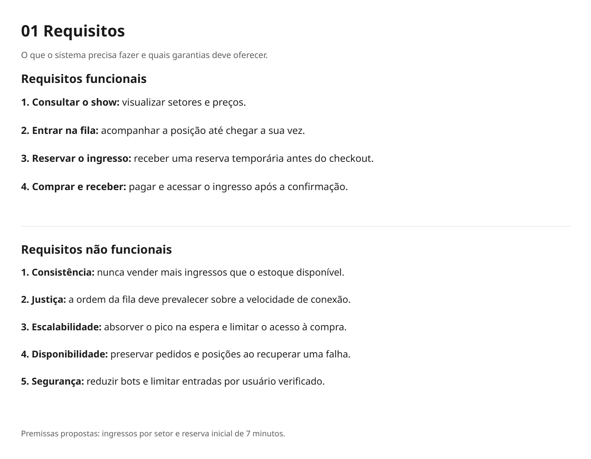
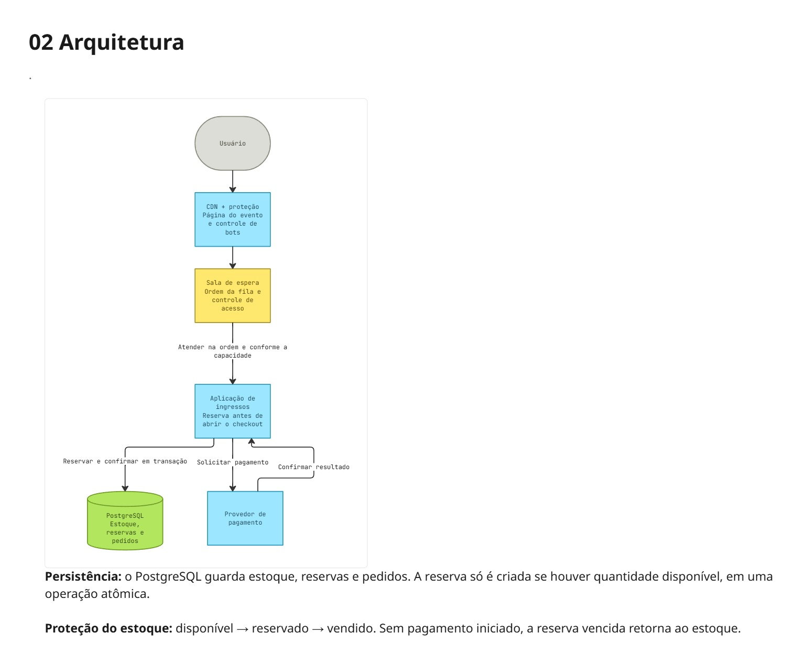
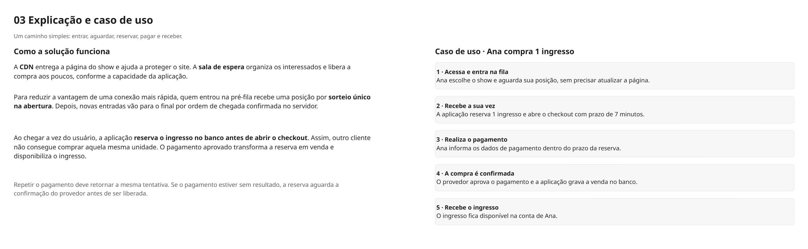

# Arquitetura

## 1. Entendendo o problema

No dia da venda, a quantidade de pessoas interessadas é muito maior que a de ingressos disponíveis. O sistema precisa manter o site acessível, organizar os compradores e confirmar apenas as compras que tenham ingresso garantido.

A solução usa uma **sala de espera** para controlar o acesso e uma **reserva no banco de dados** antes do checkout. Assim, carregar a página mais rápido não permite tomar o ingresso de alguém que já foi chamado.

## 2. Requisitos

### Requisitos funcionais

- **Consultar o show:** visualizar setores e preços.
- **Entrar na fila:** acompanhar a posição até chegar a sua vez.
- **Reservar o ingresso:** receber uma reserva temporária antes do checkout.
- **Comprar e receber:** pagar e acessar o ingresso após a confirmação.

### Requisitos não funcionais

- **Consistência:** nunca vender mais ingressos que o estoque disponível.
- **Justiça:** preservar a prioridade da fila durante a compra.
- **Escalabilidade:** absorver o pico na espera e limitar o acesso ao checkout.
- **Disponibilidade:** preservar pedidos e posições para recuperar o serviço após falhas.
- **Segurança:** reduzir bots e limitar entradas por usuário verificado.

**Premissas propostas:** ingressos por setor, sem assento numerado, e reserva inicial de **7 minutos**. Esses detalhes complementam o enunciado do exercício.

## 3. Arquitetura proposta

| Componente | Responsabilidade |
| --- | --- |
| **CDN e proteção** | Entregar a página do show e filtrar acessos abusivos. |
| **Sala de espera** | Manter a ordem dos interessados e liberar compras conforme a capacidade da aplicação. |
| **Aplicação de ingressos** | Reservar o estoque, abrir o checkout e confirmar o pedido. |
| **PostgreSQL** | Guardar estoque, reservas e pedidos e controlar as alterações concorrentes. |
| **Provedor de pagamento** | Processar o pagamento e informar o resultado à aplicação. |

O pico de acessos permanece na sala de espera. A aplicação recebe uma quantidade controlada de compradores; aumentar suas instâncias pode ampliar a capacidade, respeitando os limites do banco e do pagamento.

## 4. Como a compra funciona

**Entrada e ordem da fila.** Antes da abertura, os interessados entram em uma pré-fila. Na abertura, um sorteio único define suas posições. Depois disso, novas entradas vão para o final, pela ordem de chegada confirmada no servidor. A posição é salva para permitir a retomada da sessão.

**Reserva antes do checkout.** Quando chega a vez de uma pessoa, a aplicação verifica e reserva a quantidade solicitada em uma operação atômica no PostgreSQL. Se duas solicitações disputarem a última unidade, apenas uma poderá reservá-la. O checkout só é liberado após essa reserva.

**Pagamento e confirmação.** O provedor processa o pagamento. Com o pagamento confirmado, a aplicação transforma a reserva em venda, grava o pedido e disponibiliza o ingresso. Repetir a solicitação deve recuperar a mesma tentativa de pagamento, evitando cobranças duplicadas.

**Liberação da reserva.** Se o prazo terminar sem pagamento iniciado, o ingresso volta ao estoque. Se um pagamento estiver sem resultado, a aplicação consulta o provedor antes de liberar a reserva. Uma demora na resposta não significa que o pagamento falhou.

Essa política reduz a vantagem de conexão na abertura e protege o ingresso depois que o comprador é chamado. Após a abertura, a ordem considera a chegada ao servidor.

## 5. Persistência dos dados

| Registro | Informações principais |
| --- | --- |
| **Estoque** | Evento, setor e quantidades disponíveis, reservadas e vendidas. |
| **Reserva** | Comprador, setor, quantidade, prazo de validade e situação. |
| **Pedido** | Reserva vinculada, valor, situação do pagamento e identificador único do ingresso. |

O estoque segue o fluxo **disponível → reservado → vendido**. A criação da reserva e a atualização do estoque acontecem na mesma transação. A confirmação de um pedido também deve ocorrer uma única vez, mesmo que o provedor repita a notificação.

Se o banco não puder validar o estoque, novas compras aguardam até a recuperação do serviço.

## 6. Caso de uso: Ana compra um ingresso

1. Ana acessa o site, escolhe o show e entra na fila.
2. Quando chega sua vez, a aplicação reserva um ingresso e libera o checkout por 7 minutos.
3. Ana realiza o pagamento dentro do prazo.
4. O provedor confirma o pagamento e a aplicação grava a venda no banco.
5. O ingresso fica disponível na conta de Ana.

Enquanto Ana compra, seu ingresso está reservado. Outra pessoa com conexão mais rápida não consegue comprar aquela mesma unidade.

